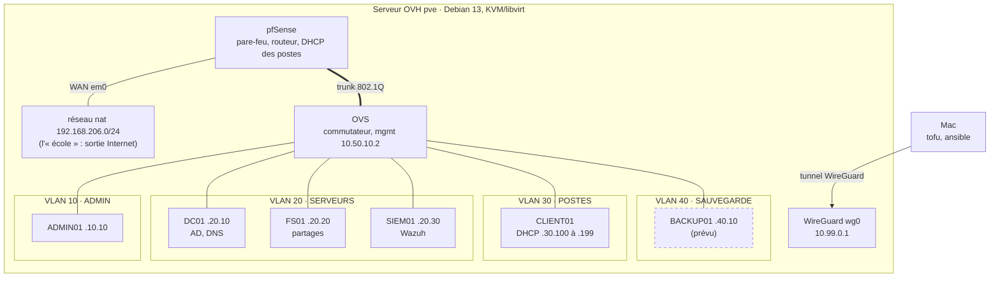
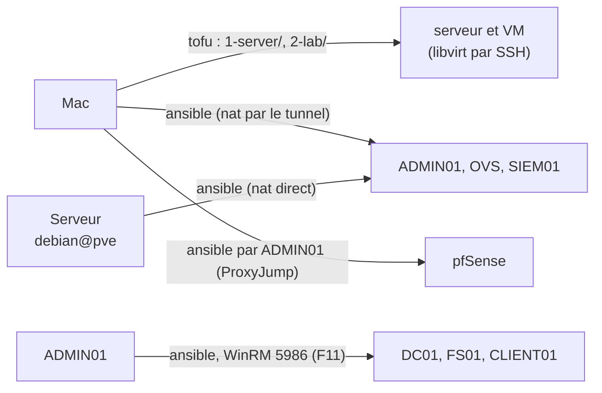
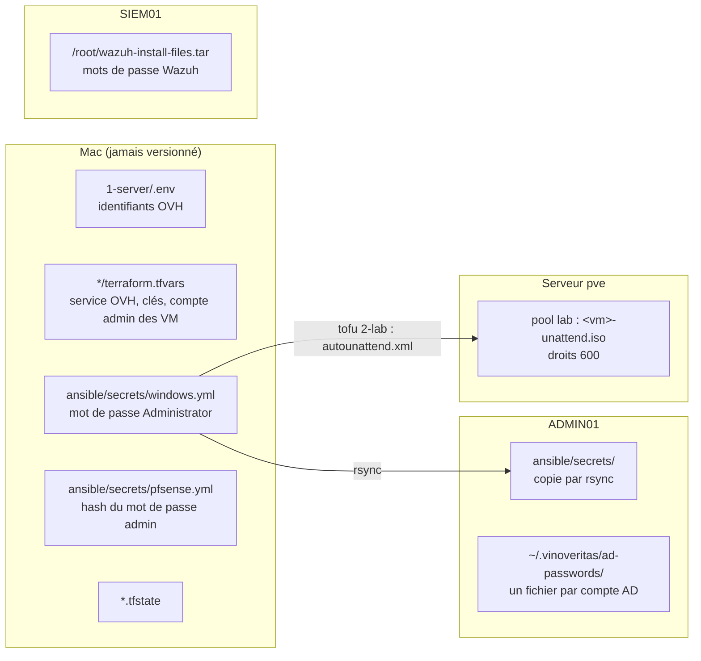

# vinoveritas-lab

Code du labo Vino Veritas : serveur OVH sous Debian 13, KVM/libvirt, réseaux et machines virtuelles du TP.

Adresses et connexions en détail : [NETWORK.md](NETWORK.md). Journal des étapes : [NOTES.md](NOTES.md).

## Architecture



- Chaque VM a son propre segment libvirt isolé (`seg-admin`, `seg-dc`, `seg-fs`, `seg-siem`, `seg-cli`, `seg-backup`), branché sur un port d'accès d'OVS. `seg-trunk` relie OVS à pfSense, qui route entre les zones et applique la matrice des flux.
- Toutes les adresses sont en `10.50.<VLAN>.x`, avec la passerelle pfSense en `.1`. Côté Ansible, elles ne sont écrites qu'une fois, dans [`ansible/group_vars/all/network.yml`](ansible/group_vars/all/network.yml).
- L'infrastructure a des adresses fixes ; les postes prennent une adresse du DHCP de pfSense.
- ADMIN01, OVS et SIEM01 ont encore une carte sur le réseau nat, temporaire (premières configurations, mises à jour).
- BACKUP01 (pointillés) : prévu, pas encore créé.

## Qui lance quoi, et d'où

Aucune machine ne joint toutes les zones : chaque commande se lance là où elle atteint ses cibles.



| Depuis | Commande | Ce qu'elle fait |
|---|---|---|
| Mac | `tofu` dans `1-server/` | Configure le serveur : WireGuard, paquets, libvirt, Cockpit |
| Mac | `tofu` dans `2-lab/` | Crée les réseaux et les VM dans libvirt, par SSH |
| Mac | `ansible-playbook pfsense.yml`, `pfsense_temporary.yml` | Configure pfSense ; ouvre ou ferme une règle temporaire (F21, F22). La collection `pfsensible.core` n'est installée que sur le Mac |
| Mac ou serveur | `ovs.yml`, `admin01.yml`, `siem01.yml`, `wazuh_agents.yml --limit admin01,ovs` | Configure les VM Debian |
| ADMIN01 | `dc01.yml`, `ad_users.yml`, `fs01.yml`, `file_shares.yml`, `client01.yml`, `wazuh_agents.yml --limit windows` | Configure les machines Windows (seul ADMIN01 les joint) |
| ADMIN01 | `bash scripts/trigger-events.sh` | Déclenche des événements de sécurité pour remplir les tableaux de bord Wazuh |

`tofu` reste sur le Mac, là où sont ses fichiers d'état. Pour ADMIN01, on copie d'abord `ansible/` depuis le Mac, secrets compris (commandes `rsync` en tête de `dc01.yml`).

## Contrôles

Chaque playbook se termine par des plays de contrôle, en lecture seule, marqués du tag `verify` :

```bash
ansible-playbook pfsense.yml --tags verify
```

`verify.yml` les lance tous, en deux passages (un par point de départ) :

```bash
ansible-playbook verify.yml --tags verify --limit pfsense,ovs,siem01,admin01
```

```bash
ansible-playbook verify.yml --tags verify --limit windows
```

Le premier depuis le Mac ou le serveur, le second depuis ADMIN01. Sans `--tags verify`, `verify.yml` s'arrête avant de rien faire (sinon il configurerait les machines).

## Structure

```
1-server/   serveur OVH déjà loué : réinstallation Debian, WireGuard, paquets, libvirt, Cockpit (OpenTofu, provider ovh/ovh)
2-lab/      réseaux, segments et VM du labo dans libvirt (OpenTofu, provider dmacvicar/libvirt, par SSH) :
            un fichier par machine (admin01.tf, ovs.tf, pfsense.tf, dc01.tf, fs01.tf, client01.tf, siem01.tf),
            images.tf pour les images et ISO, modules/ pour ce qui est commun (debian_vm, windows_vm, server_iso)
ansible/    configuration de l'intérieur des VM :
              playbooks     un par machine ou par mission (pfsense.yml, dc01.yml, file_shares.yml…), verify.yml
              group_vars/   all/network.yml (adresses), windows/users.yml (comptes), windows/shares.yml (partages)
              host_vars/    pfsense.yml (zones, DHCP, alias, règles), ovs.yml (ports)
              roles/        un rôle par machine ou par fonction (ad_users, file_shares, wazuh…), chacun avec son verify.yml
              scripts/      trigger-events.sh
later/      ancien code complet du labo, pas utilisé
```

## Ordre de lancement

1. Mac, `1-server/` : `dotenvx run -- tofu apply`.
2. Mac : tunnel WireGuard actif, puis une fois `ssh debian@10.99.0.1` (clé d'hôte).
3. Mac, `2-lab/` : `tofu apply` crée les réseaux et les VM ; `tofu output ssh` donne leurs adresses sur nat.
4. Mac ou serveur : `ovs.yml`, puis `admin01.yml`, puis `siem01.yml`.
5. Mac : `pfsense.yml` (zones, DHCP, règles).
6. ADMIN01 : `dc01.yml`, `ad_users.yml`, `fs01.yml`, `file_shares.yml`.
7. CLIENT01 : F21 activée (`pfsense_temporary.yml -e rule=F21 -e enabled=true`), `client01.yml` depuis ADMIN01, F21 désactivée.
8. Agents Wazuh : `wazuh_agents.yml --limit admin01,ovs` (Mac ou serveur), puis `--limit windows` (ADMIN01).
9. Les deux passages de `verify.yml`.

Consoles des VM (VNC, écoute locale au serveur) : `ssh -L 5900:127.0.0.1:5900 debian@10.99.0.1`, puis `vnc://localhost:5900` (`virsh vncdisplay <vm>` donne le numéro). Ou Cockpit, page Machines : `https://10.99.0.1:9090`.

## Secrets et mots de passe

Rien de sensible n'est versionné (voir `.gitignore`). Où trouver chaque secret :



| Secret | Où | Comment le lire |
|---|---|---|
| Identifiants OVH | `1-server/.env` (Mac) | — |
| Service OVH, clé WireGuard du Mac | `1-server/terraform.tfvars` (Mac) | — |
| Compte admin des VM Debian | `2-lab/terraform.tfvars` (Mac), modèle dans `terraform.tfvars.example` | — |
| `Administrator` des Windows (local et domaine) | `ansible/secrets/windows.yml` (Mac, copié sur ADMIN01) ; lu aussi par `2-lab/` pour l'installation | `cat ansible/secrets/windows.yml` |
| Compte `admin` de pfSense | `ansible/secrets/pfsense.yml` (hash) ; connexion par clé SSH | — |
| Mots de passe initiaux des comptes AD | ADMIN01, `~/.vinoveritas/ad-passwords/<login>` et `adm-<login>` (droits 600) | `cat ~/.vinoveritas/ad-passwords/claire.martin` |
| Console Wazuh | SIEM01, `/root/wazuh-install-files.tar` | `sudo tar -O -xf /root/wazuh-install-files.tar wazuh-install-files/wazuh-passwords.txt` |

Les mots de passe des comptes AD ne servent qu'une fois : ils sont expirés à la création, Windows en fait choisir un nouveau à la première ouverture de session, et le fichier ne suit pas. Un mot de passe perdu se réinitialise dans l'AD (RDP sur DC01, ou `Set-ADAccountPassword -Reset`), pas en relançant `ad_users.yml`.

L'état (`*.tfstate`) reste sur le Mac et n'est jamais commité. Le mot de passe `Administrator` n'y est pas (vérifié) : il n'est écrit que dans l'ISO d'installation de chaque VM Windows, sur le serveur (droits 600).
