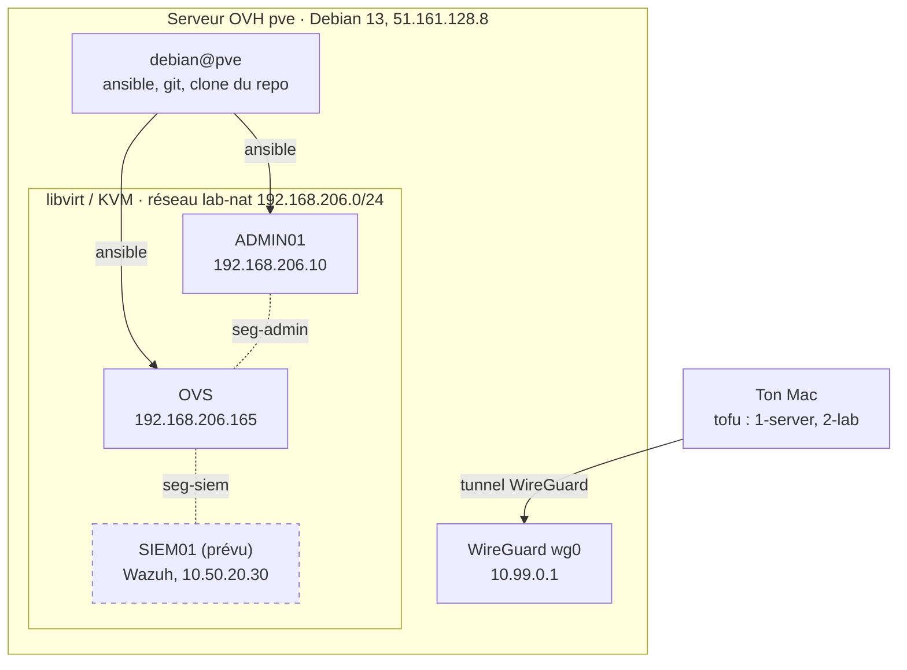

# vinoveritas-lab

Code du labo Vino Veritas : serveur OVH sous Debian 13, KVM/libvirt, réseaux et machines virtuelles du TP.

## Architecture



Les pointillés autour de SIEM01 : machine prévue, pas encore créée. Les 7 segments isolés (`seg-admin`, `seg-dc`, `seg-fs`, `seg-cli`, `seg-backup`, `seg-siem`, `seg-trunk`) sont tous reliés à OVS.

## Qui lance quoi, et d'où

| Depuis | Commande | Ce qu'elle fait |
|---|---|---|
| Mac | `tofu` dans `1-server/` | Configure le serveur : WireGuard, paquets, libvirt |
| Mac | `tofu` dans `2-lab/` | Crée les réseaux et les VM dans libvirt (par le tunnel) |
| Serveur (`debian@pve`) | `ansible-playbook` dans `ansible/` | Configure l'intérieur des VM : OVS, outils d'ADMIN01 |

`tofu` reste sur le Mac, là où sont ses fichiers d'état. Ansible tourne sur le serveur.

Adresses et connexions : voir [NETWORK.md](NETWORK.md). Journal des étapes : voir [NOTES.md](NOTES.md).

## Structure

```
1-server/   serveur OVH déjà loué : réinstallation Debian, WireGuard, paquets, libvirt, Cockpit (OpenTofu, provider ovh/ovh)
2-lab/      réseaux, segments et VM du labo dans libvirt (OpenTofu, provider dmacvicar/libvirt, par SSH) :
            un fichier par machine (admin01.tf, ovs.tf, pfsense.tf, dc01.tf, fs01.tf, client01.tf, siem01.tf),
            images.tf pour les images et ISO, modules/ pour ce qui est commun (debian_vm, windows_vm, server_iso)
ansible/    configuration des VM : rôles ovs, devtools, admin, server_access
later/      code complet du labo (pfSense, Windows), pas encore utilisé
```

## Ordre de lancement

1. Mac, `1-server/` : `dotenvx run -- tofu apply` installe WireGuard, les paquets, libvirt et Cockpit (optionnel, voir `1-server/cockpit.tf`).
2. Mac : tunnel WireGuard actif, puis une fois `ssh debian@10.99.0.1` (clé d'hôte).
3. Mac, `2-lab/` : `tofu apply` crée les réseaux et les VM ; `tofu output ssh` donne leurs adresses.
4. Serveur, `ansible/` : `git pull`, puis `ansible-playbook ovs.yml` et `ansible-playbook admin01.yml`.

Consoles des VM (VNC, écoute locale au serveur) : `ssh -L 5900:127.0.0.1:5900 debian@10.99.0.1`, puis `vnc://localhost:5900` (5901, 5902… pour les VM suivantes ; `virsh vncdisplay <vm>` donne le numéro).

## Secrets

Rien de sensible n'est versionné (voir `.gitignore`). Il faut à la main :

- `1-server/.env` : identifiants OVH ;
- `1-server/terraform.tfvars` : nom de service OVH, clé publique WireGuard du Mac ;
- `2-lab/terraform.tfvars` : compte admin des VM (sinon `root` par défaut).

L'état (`*.tfstate`) reste sur le Mac et n'est jamais commité.
